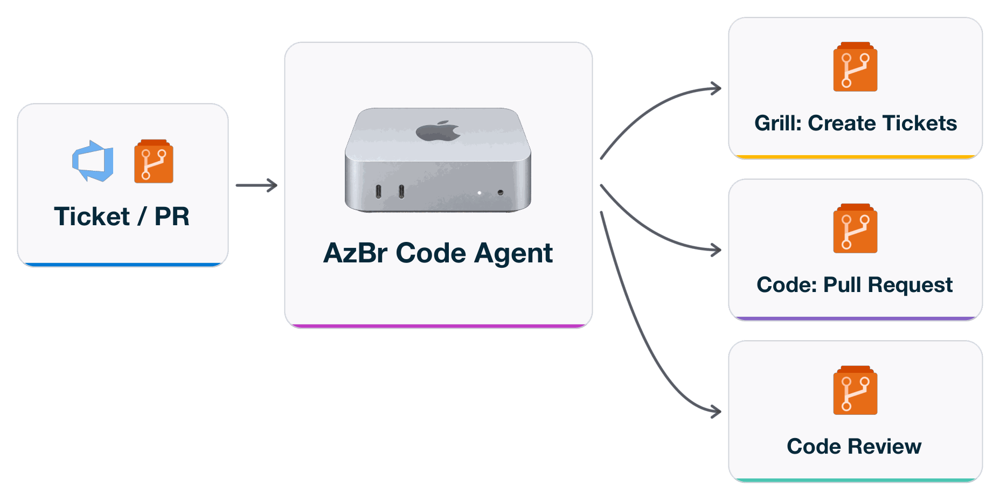
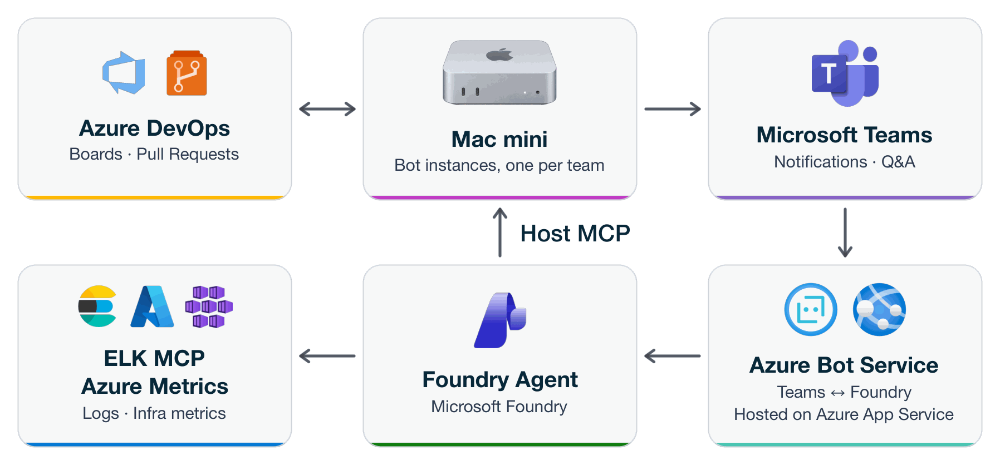

<a name="start-building"></a>

<p align="center">

</p>

# [Microsoft Ignite 2026](https://ignite.microsoft.com)

## 🔥THR1002: From ticket to PR: field lessons from an autonomous code agent

### Session description

Most teams already use coding agents, but each team uses them differently: different prompts, tools, and steps, with no shared process to automate. This session shows the **AzBr Code Agent**, an internal coding agent built by [AzureBrasil.cloud](https://www.azurebrasil.cloud/) on Azure that runs one normalized flow for every team: **Grill → Coding → Code Review**. A new ticket or pull request in Azure DevOps triggers the agent. It matures the ticket, plans and implements it with GitHub Copilot sub-agents, reviews every PR against the original ticket, and answers questions about its work in Microsoft Teams through a Microsoft Foundry agent that uses MCP and A2A.

<picture>
  <source media="(prefers-color-scheme: dark)" srcset="img/diagrams/agent-flow-dark.png">
  
</picture>

> [!NOTE]
> The AzBr Code Agent is not open source. This repository shares the architecture, the field lessons, and generic GitHub Copilot agents you can adapt to build the same flow on your own stack.

### 📈 In production today

| Pull requests reviewed by the agent | Tickets coded end to end by the agent | Teams using it |
|:---:|:---:|:---:|
| **100%** | **~20%** | **All teams** |

The agent also helps teams with observability: anyone can ask about a ticket, its implementation, logs, or infrastructure metrics right in Microsoft Teams. Read what we learned in [field lessons](docs/field-lessons.md).

### 🏗️ Architecture at a glance

<picture>
  <source media="(prefers-color-scheme: dark)" srcset="img/diagrams/architecture-dark.png">
  
</picture>

Full walkthrough: [how it works](docs/how-it-works.md) · [architecture](docs/architecture.md)

### 📂 What's in this repository

| Path | What you'll find |
|------|------------------|
| [`docs/how-it-works.md`](docs/how-it-works.md) | The Grill → Coding → Code Review flow, step by step, with diagrams |
| [`docs/architecture.md`](docs/architecture.md) | Components, MCP and A2A tools, design choices, and how to secure tool calls |
| [`docs/field-lessons.md`](docs/field-lessons.md) | Production numbers, lessons learned, recommendations, and a go-live checklist |
| [`docs/community-content.md`](docs/community-content.md) | Related articles, videos, and samples |
| [`src/agents/`](src/agents/) | Five generic GitHub Copilot custom agents: grill, ticket-readiness, planner, implementer, code-reviewer |

### 🚀 Getting started

#### On your own

**You need:** VS Code with [GitHub Copilot](https://docs.github.com/en/copilot) (agent mode), a Git repository you can experiment on, and optionally an Azure DevOps project and a Microsoft Foundry project if you want to automate the flow end to end.

1. Clone this repository:

   ```shell
   git clone https://github.com/microsoft/ignite26-THR1002.git
   ```

2. Read the flow in [`docs/how-it-works.md`](docs/how-it-works.md).
3. Copy the agents from [`src/agents/`](src/agents/) into the `.github/agents/` folder of your own repository.
4. In Copilot Chat, pick the **grill** agent and paste a raw ticket. Then run **ticket-readiness**, **planner**, **implementer**, and **code-reviewer** in order. See [`src/README.md`](src/README.md).
5. When the manual flow works for your team, automate it: trigger the same agents from Azure DevOps [service hooks](https://learn.microsoft.com/azure/devops/service-hooks/overview) based on work item state and labels, and post every action to a Microsoft Teams channel.
6. Before you go to production, go through the checklist in [`docs/field-lessons.md`](docs/field-lessons.md#before-you-go-to-production).

### 🎯 Learning outcomes

By the end of this session, you will be able to:

- Build a Grill → Coding → Code Review flow with GitHub Copilot custom agents that turns raw tickets into reviewed pull requests
- Gate autonomous coding with human checkpoints: resolved decisions, a ticket readiness check, and an approved implementation plan
- Expose agent activity to your team in Microsoft Teams through a Microsoft Foundry agent that uses MCP and A2A tools for tickets, logs, and infrastructure metrics

### 💻 Technologies used

- [GitHub Copilot](https://docs.github.com/en/copilot): agent mode, [custom agents](https://docs.github.com/en/copilot/how-tos/copilot-on-github/customize-copilot/customize-cloud-agent/create-custom-agents), sub-agents, and [Copilot CLI](https://docs.github.com/en/copilot/concepts/copilot-surfaces/copilot-cli)
- Azure DevOps: [Boards](https://learn.microsoft.com/azure/devops/boards/), [pull requests](https://learn.microsoft.com/azure/devops/repos/git/pull-requests), and [service hooks](https://learn.microsoft.com/azure/devops/service-hooks/overview)
- [Microsoft Foundry Agent Service](https://learn.microsoft.com/azure/foundry/agents/overview) with [MCP tools](https://learn.microsoft.com/azure/foundry/agents/how-to/tools/model-context-protocol)
- [Microsoft Agent Framework](https://learn.microsoft.com/agent-framework/overview/) (.NET)
- [Azure Bot Service](https://learn.microsoft.com/azure/bot-service/) hosted on [Azure App Service](https://learn.microsoft.com/azure/app-service/)
- [Microsoft Teams](https://learn.microsoft.com/microsoftteams/platform/)
- [Azure Monitor metrics](https://learn.microsoft.com/azure/azure-monitor/metrics/data-platform-metrics) and Elastic (ELK) for logs
- [Model Context Protocol (MCP)](https://modelcontextprotocol.io) and [Agent2Agent (A2A)](https://a2a-protocol.org/)

### 🤖 Keep learning with Copilot

Open this repository in VS Code. The Microsoft Learn MCP Server is already configured in [`.vscode/mcp.json`](.vscode/mcp.json). Then try these prompts in Copilot Chat:

- `Using Microsoft Learn, show me how to connect a Microsoft Foundry Agent Service agent to a remote MCP server, and write a minimal .NET MCP server that returns the status of a ticket.`
- `Using Microsoft Learn, explain how Azure DevOps service hooks can call a web endpoint when a work item changes state or a pull request is created. Then sketch an ASP.NET Core endpoint that decides whether to run grill, coding, or code review based on the work item state and tags.`
- `Read src/agents/code-reviewer.agent.md and docs/field-lessons.md. Adapt the reviewer to my repository's conventions and suggest which checks should block a merge and which should only comment.`

### 📚 Continue your learning

Pick your next step based on your learning style:

| Resource | What you'll get |
|----------|-----------------|
| **[Ignite 2026 Next Steps](https://aka.ms/ignite26-next-steps)** | Additional session repos and materials from Microsoft Ignite 2026 |
| **[Microsoft AI Skills Navigator](https://aka.ms/ignite26-asn)** | Discover AI skills, learning paths, and resources for your next step |
| **[Microsoft Learn](https://aka.ms/ignite26-learn)** | Official documentation and guided learning paths on these topics |
| **[Microsoft Foundry Community](https://aka.ms/MicrosoftFoundryDiscord-Ignite26)** | Connect with other learners and experts in our Discord community |
| **[Field lessons](docs/field-lessons.md)** | What running a coding agent for every team taught us, and what I recommend |
| **[Articles and videos](docs/community-content.md)** | Deep dives on GitHub Copilot agents, Microsoft Foundry, MCP, and A2A (mostly in Portuguese) |
| **[AzureBrasil.cloud](https://www.azurebrasil.cloud/)** | Official website of AzureBrasil.cloud, the company behind the AzBr Code Agent |

### 🌟 Microsoft Learn MCP Server

The Microsoft Learn MCP Server gives your AI agent direct access to Microsoft's official documentation — grounded, up-to-date answers about the topics in this session. It's already configured for this repository in [`.vscode/mcp.json`](.vscode/mcp.json).

**GitHub Copilot CLI** — Install with:

```shell
copilot plugin install microsoftdocs/mcp
```

**VS Code** — One-click install:  
[](https://vscode.dev/redirect/mcp/install?name=microsoft-learn&config=%7B%22type%22%3A%22http%22%2C%22url%22%3A%22https%3A%2F%2Flearn.microsoft.com%2Fapi%2Fmcp%22%7D)

For more information, visit the [Learn MCP Server repo](https://aka.ms/learnmcp).

### 🏢 About AzureBrasil.cloud

[AzureBrasil.cloud](https://www.azurebrasil.cloud/) is one of the largest Microsoft partners in Brazil, working exclusively with Microsoft technologies. Our mission is to evangelize Microsoft technologies and guide companies through their journey with them. The AzBr Code Agent is part of that journey: we built it for our own teams, on Azure, and share the pattern here.

### 👥 Content owners

<table>
<tr>
    <td align="center"><a href="https://github.com/TallesValiatti">
        <br />
        <sub><b>Talles Valiatti</b></sub></a><br />
            <sub>Cloud Developer Advocate · Microsoft MVP</sub><br />
            <sub><a href="https://www.azurebrasil.cloud/">AzureBrasil.cloud</a></sub><br /><br />
            <sub>
              <a href="https://tallesvaliatti.com">Website</a> ·
              <a href="https://www.linkedin.com/in/tallesvaliatti">LinkedIn</a> ·
              <a href="https://github.com/TallesValiatti">GitHub</a> ·
              <a href="https://www.youtube.com/@azurebrasilcloud">YouTube</a>
            </sub>
    </td>
</tr></table>

### ⚖️ Trademarks

This project may contain trademarks or logos for projects, products, or services. Authorized use of Microsoft trademarks or logos is subject to and must follow [Microsoft's Trademark & Brand Guidelines](https://www.microsoft.com/legal/intellectualproperty/trademarks/usage/general). Use of Microsoft trademarks or logos in modified versions of this project must not cause confusion or imply Microsoft sponsorship.

Any use of third-party trademarks or logos are subject to those third-party's policies.
