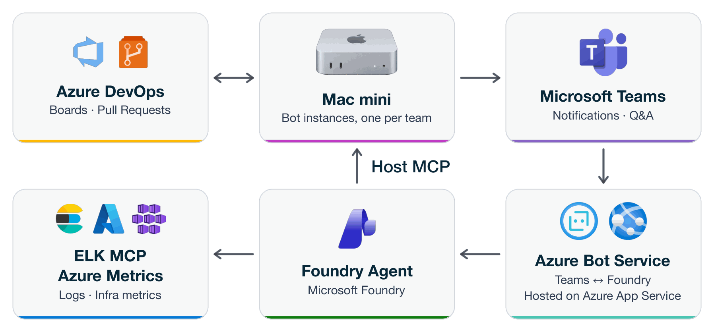
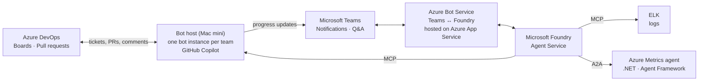
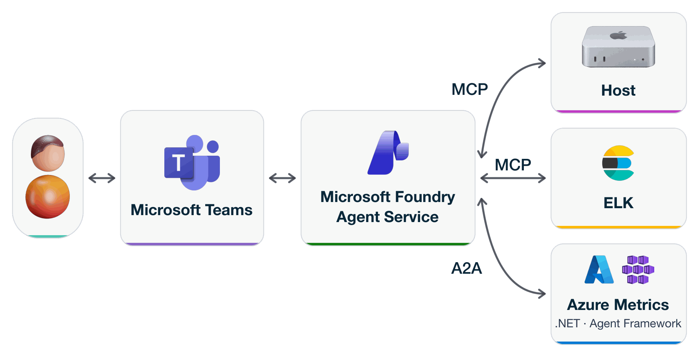

# Architecture

How the bot, Azure DevOps, Microsoft Teams, and Microsoft Foundry connect. The AzBr Code Agent is built by [AzureBrasil.cloud](https://www.azurebrasil.cloud/) on Azure services. It's an internal solution, not open source.

<picture>
  <source media="(prefers-color-scheme: dark)" srcset="../img/diagrams/architecture-dark.png">
  
</picture>

Text version (Mermaid)

## Components

| Component | Role |
|-----------|------|
| **Azure DevOps** | Where work lives. Work item state and labels decide what the agent does. The agent writes tickets, opens PRs, and comments on PRs here. |
| **Bot host (Mac mini)** | Runs one bot instance per team. Each instance drives GitHub Copilot through the Grill, Coding, and Code Review steps. It also exposes an MCP server with ticket and implementation data. |
| **GitHub Copilot** | The coding engine: grills tickets, checks readiness, plans, runs sub-agents per task, and reviews PRs. |
| **Microsoft Teams** | One channel per bot instance. The bot posts every action, and people ask questions there. |
| **Azure Bot Service** | Connects Teams to the Foundry agent. Hosted on Azure App Service. |
| **Microsoft Foundry Agent Service** | The Q&A agent. It answers questions about tickets, implementations, logs, and infrastructure using its tools. |

## Agent tools: MCP and A2A

<picture>
  <source media="(prefers-color-scheme: dark)" srcset="../img/diagrams/agent-tools-dark.png">
  
</picture>

- **MCP (Model Context Protocol):** the Foundry agent reads ticket and implementation data from the bot host, and logs from ELK.
- **A2A (Agent2Agent):** the Foundry agent asks an Azure Metrics agent, built with .NET and Microsoft Agent Framework, for infrastructure metrics. For a similar open-source agent, see [AzureExploreAgent](https://github.com/AzureBrasil-cloud/AzureExploreAgent).

## Design choices

- **One instance per team.** Each team has its own repository access, context, and Teams channel.
- **The board is the control plane.** No new UI. People move tickets and add labels the way they already do.
- **Read paths go through tools.** The Q&A agent doesn't get broad access. It reads through specific MCP tools and asks another agent (A2A) for metrics.

## Securing the tool calls

When you build this yourself, protect the MCP servers the Foundry agent calls. These walkthroughs show how (in Portuguese):

- [Microsoft Foundry with Managed Identity calling an MCP server protected by Microsoft Entra ID](https://www.azurebrasil.cloud/blog/microsoft-foundry-com-managed-identity-consumindo-um-mcp-server-protegido-pelo-microsoft-entra-id/)
- [OAuth identity passthrough in Foundry Agent Service with a custom .NET MCP server](https://www.azurebrasil.cloud/blog/oauth-identity-passthrough-no-foundry-agent-service-com-mcp-server-customizado-em-net-parte-1/)
- [Consuming Microsoft Foundry through an Azure VNet](https://tallesvaliatti.com/consumindo-o-microsoft-foundry-via-azure-vnet-parte-1-3b430d46998f)

For the Teams → Azure Bot Service → Foundry path, see the [Teams Audio Summarizer sample](https://github.com/TallesValiatti/MsftFoundryTeamsAudioSummarize).
