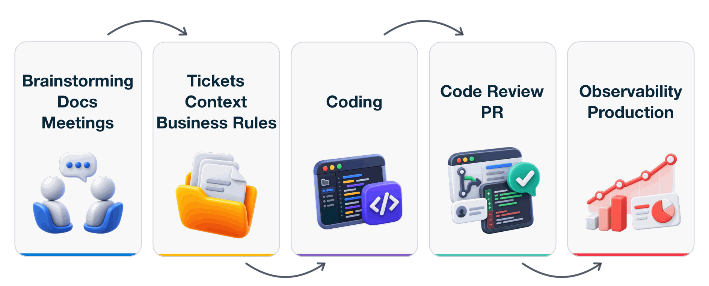
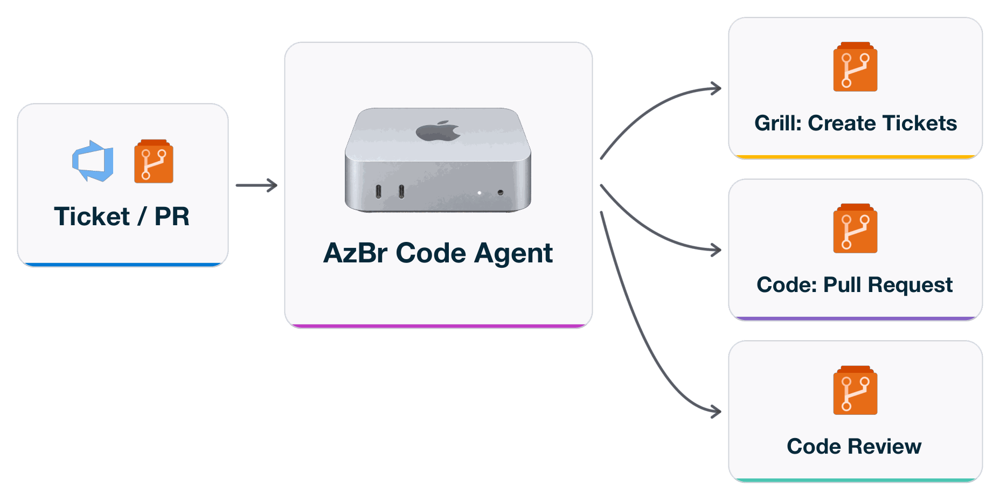
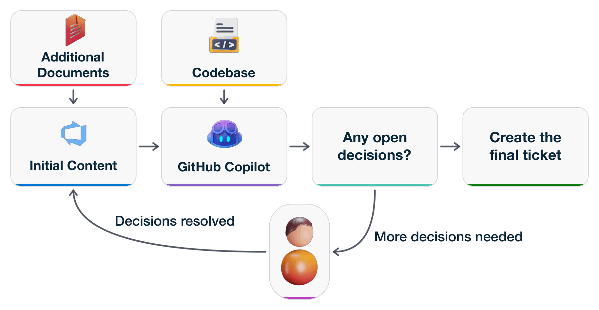
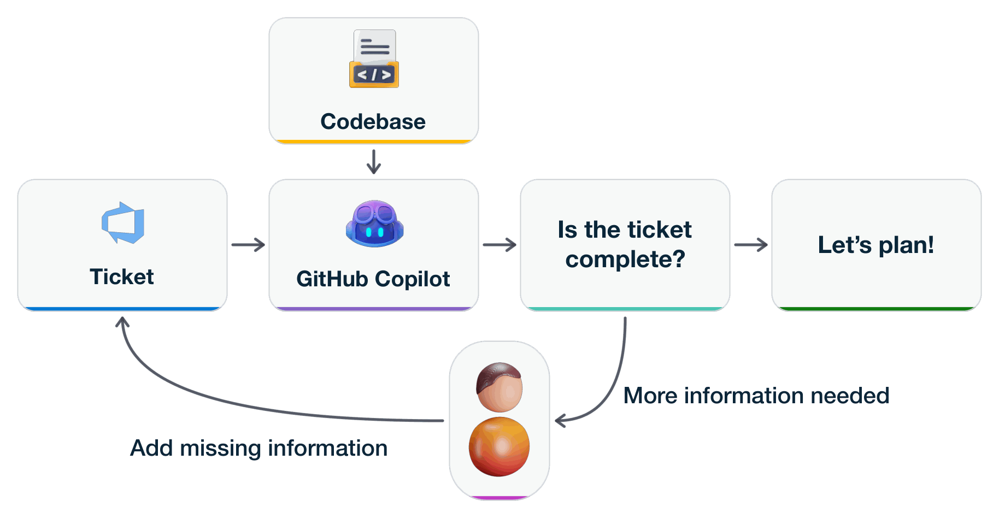
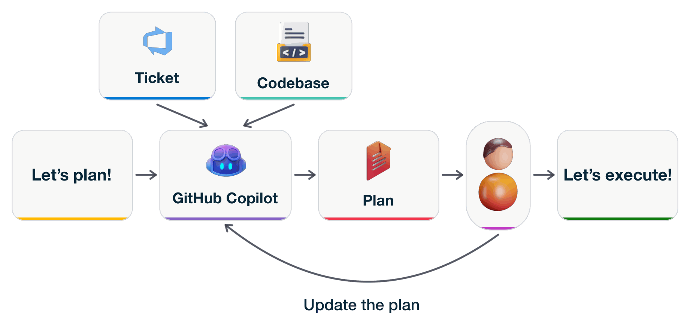
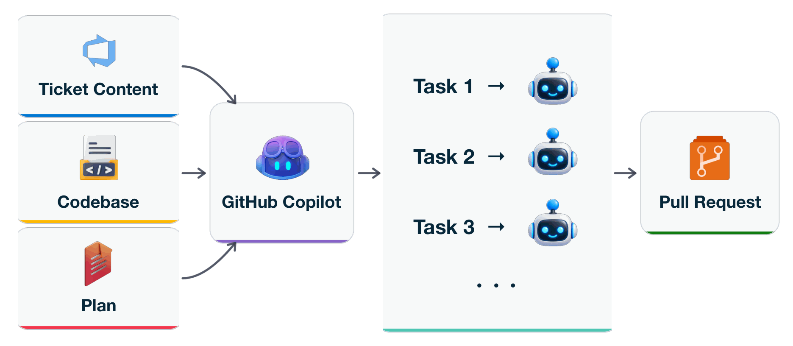
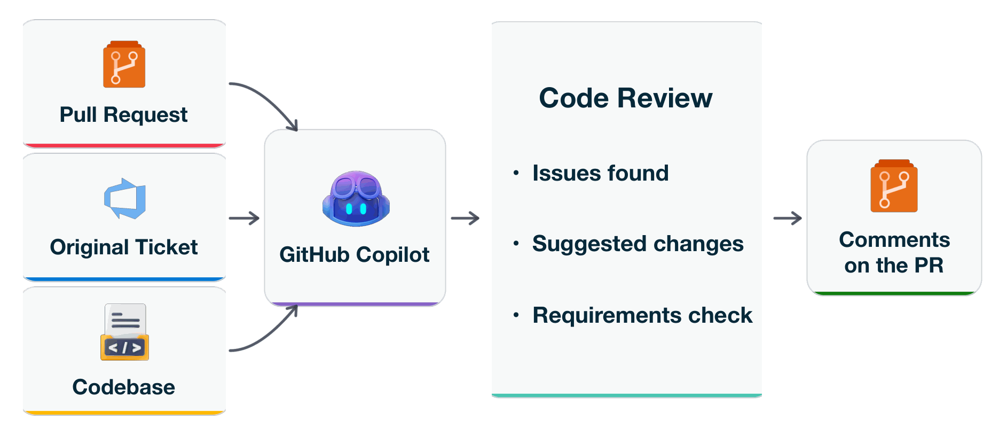
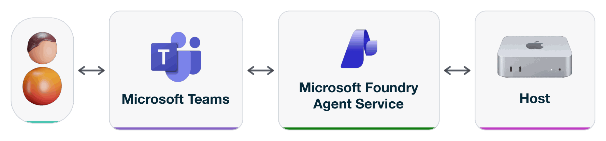

# How the AzBr Code Agent works

The AzBr Code Agent is a GitHub Copilot-powered bot that gives every team the same coding flow: **Grill → Coding → Code Review**. Each team gets its own bot instance.

## The problem it solves

| Before | After |
|--------|-------|
| Each team used code agents differently | One coding process for every team |
| Different prompts, tools, and steps | Same flow: Grill → Coding → Review |
| No shared process to build on | A normalized, repeatable workflow |
| Hard to automate across teams | Ready to be automated end to end |

**The result:** every team gained one more teammate, a virtual one.

## Where an agent can help

<picture>
  <source media="(prefers-color-scheme: dark)" srcset="../img/diagrams/delivery-flow-dark.png">
  
</picture>

Every handoff between stages is a chance for an AI agent to take on routine work. The AzBr Code Agent covers tickets, coding, code review, and observability.

## The trigger

<picture>
  <source media="(prefers-color-scheme: dark)" srcset="../img/diagrams/agent-flow-dark.png">
  
</picture>

A new ticket or pull request on the Azure DevOps board triggers the agent. **The work item's state and labels decide the action**: grill the ticket, write the code, or review the PR. The board is the agent's state machine, so the team doesn't need a separate tool to tell the agent what to do.

## 1. Grill: maturing the ticket

<picture>
  <source media="(prefers-color-scheme: dark)" srcset="../img/diagrams/grill-dark.png">
  
</picture>

**Input:** the ticket's initial content, the codebase, and any additional documents.

GitHub Copilot questions the ticket and looks for open decisions. While any are left, it asks a person. When every decision is resolved, it writes the final ticket.

**Why:** vague tickets become vague PRs. Grilling moves the ambiguity to the cheapest place to fix it, before any code exists.

Agent: [`src/agents/grill.agent.md`](../src/agents/grill.agent.md)

## 2. Coding

### 2a. Is the ticket ready?

<picture>
  <source media="(prefers-color-scheme: dark)" srcset="../img/diagrams/coding-readiness-dark.png">
  
</picture>

Before writing any code, the agent checks the ticket against the codebase. If anything is missing, it asks a person first, so coding starts from complete requirements.

Agent: [`src/agents/ticket-readiness.agent.md`](../src/agents/ticket-readiness.agent.md)

### 2b. Building the plan

<picture>
  <source media="(prefers-color-scheme: dark)" srcset="../img/diagrams/coding-plan-dark.png">
  
</picture>

Using the ticket and the codebase as context, the agent drafts an implementation plan. **A person reviews it**, and the agent updates the plan until it's approved.

Agent: [`src/agents/planner.agent.md`](../src/agents/planner.agent.md)

### 2c. Executing the plan

<picture>
  <source media="(prefers-color-scheme: dark)" srcset="../img/diagrams/coding-execute-dark.png">
  
</picture>

The approved plan is split into tasks, and a sub-agent runs each one. Together, the sub-agents produce **one pull request**.

Agent: [`src/agents/implementer.agent.md`](../src/agents/implementer.agent.md)

## 3. Code review

<picture>
  <source media="(prefers-color-scheme: dark)" srcset="../img/diagrams/code-review-dark.png">
  
</picture>

The agent reviews **every new PR**, including PRs written by people, against the original ticket and the codebase. It comments directly on the PR with:

- issues found
- suggested changes
- a requirements check: does the PR do what the ticket asked?

Agent: [`src/agents/code-reviewer.agent.md`](../src/agents/code-reviewer.agent.md)

## 4. Observability: asking the agent in Teams

<picture>
  <source media="(prefers-color-scheme: dark)" srcset="../img/diagrams/teams-qa-dark.png">
  
</picture>

Every bot instance reports its progress to a Microsoft Teams channel. Anyone can ask about a ticket or how it was implemented, right in the chat. A Microsoft Foundry agent answers:

- through **MCP**, it reads ticket and implementation data from the bot host and logs from ELK
- through **A2A**, it gets infrastructure metrics from an Azure Metrics agent built with .NET and Microsoft Agent Framework

See [architecture](architecture.md#agent-tools-mcp-and-a2a).

## Where people stay in the loop

| Step | Who decides |
|------|-------------|
| Grill | People answer the open decisions |
| Ticket readiness | People add missing information |
| Plan | People approve the plan before execution |
| Pull request | People merge, after the agent's review |
